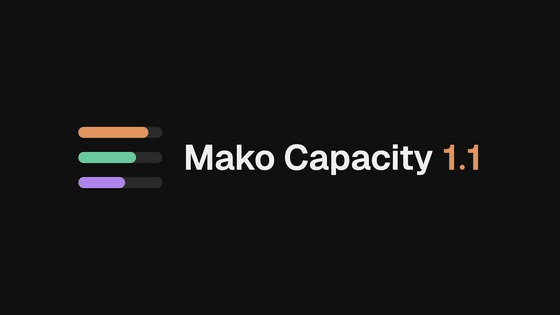

# Changelog

What changed in each version of Mako Capacity. The newest version is first.

## 1.1.0

[Watch the film with sound](https://mako-l.github.io/account-capacity-dock/media/whats-new-1.1.mp4) (22 seconds, demo data).

### Agents
- An agents dock on macOS. A switch at the top of the capacity dock moves between accounts and agents.
- Each agent shows a progress ring and a status colour: yellow working, red needs you, green finished.
- Agent cards use the Herdr workspace and tab names.
- Agent cards show the task, the current step and each step's time.
- Subagents get their own cards with steps and progress. Workflows show their phases.
- Subagents list running first, then finished, then idle.
- Each agent and subagent shows its tokens, its API-equivalent cost and about how much of a weekly limit it used.
- Idle agents and recent activity are hidden by default. Two settings show them.

### Accounts
- The dock reads the local Claude Code and Codex logins, so it works without a proxy.
- Each quota window shows its spend in tokens and dollars, and the share of the plan price.
- Each window shows when it fills at the current pace, and how long it took to use up.
- Per-account tokens and cost from the proxy's usage tracker.
- `mako-capacity credentials export`, `import` and `copy` move logins between proxies.

### Terminal and Herdr
- A GPUIX app for the dock, All accounts and Settings, in a window or in the terminal.
- A plain-text agents widget for Herdr: `pin-agents-text-right`.
- Pin the GPUIX app in Herdr, and hide account names.
- Half-density frames cut the lag inside Herdr. Clicks and scrolling work there.

### Fixes
- A step the observer renames as it finishes keeps its time. Steps with no known time show none, not 0.
- A stopped agent's step stops counting. Run time counts from the last request.
- A subagent inside a long tool call stays running.
- Quiet teammates show as idle, not finished.
- Per-account usage refreshes even when CodeBurn is skipped.

## 1.0.0

First stable release.

- A dock with a quota ring per account, hover details and an All accounts dashboard.
- Hide, restore and delete accounts from the dashboard.
- Claude and Codex logins through one CLIProxyAPI, local or on another machine.
- A Herdr widget with rings, layouts that follow the pane width, and pinning.
- Today's local token use and API-equivalent cost from CodeBurn.
