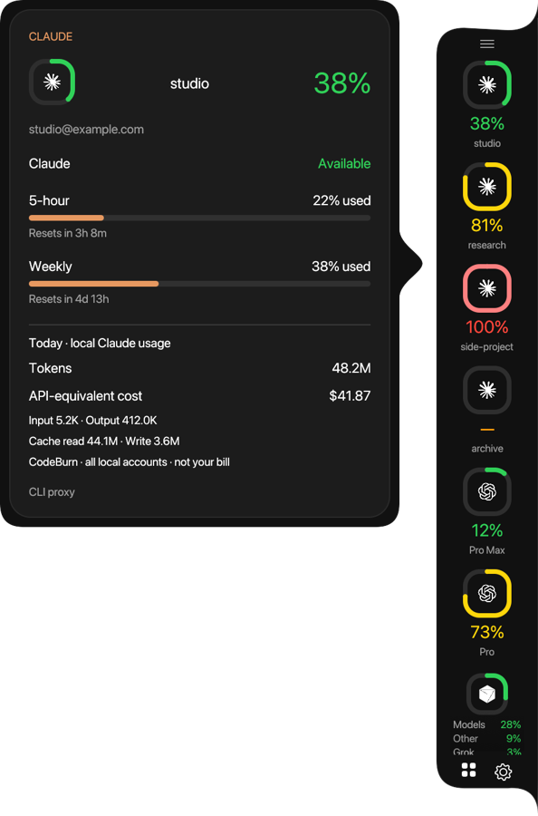
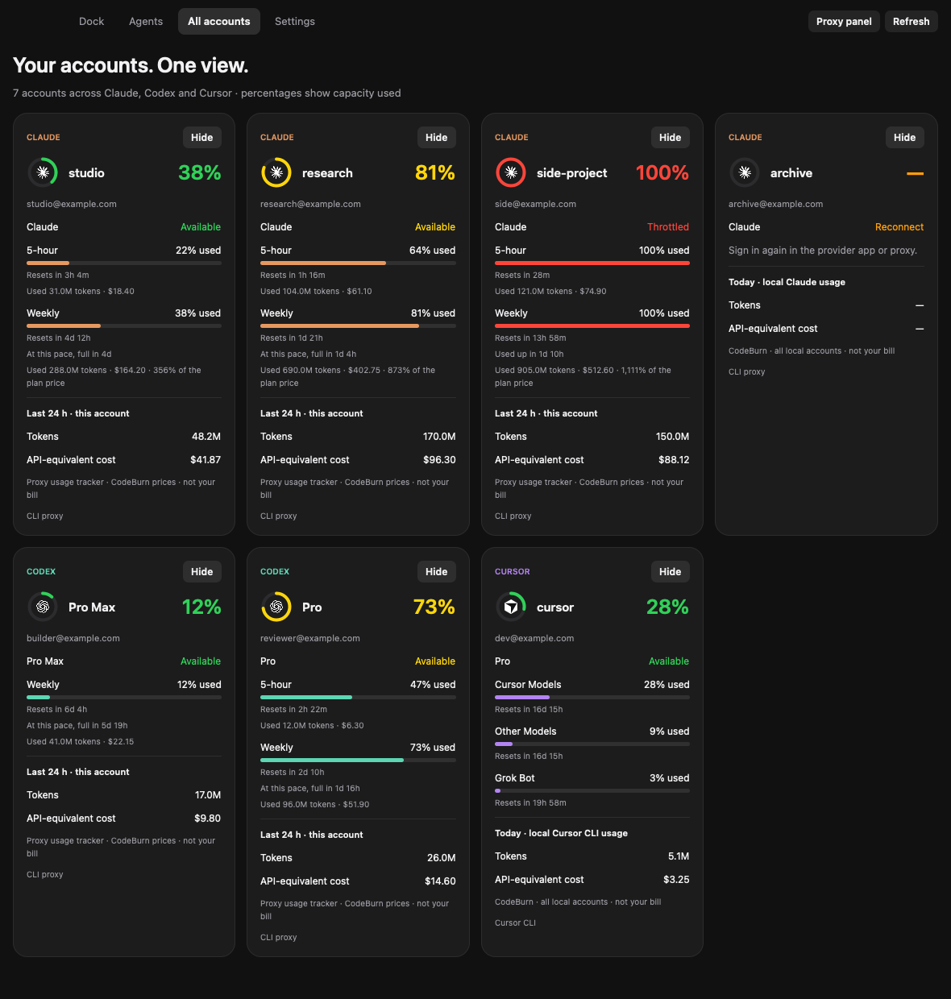
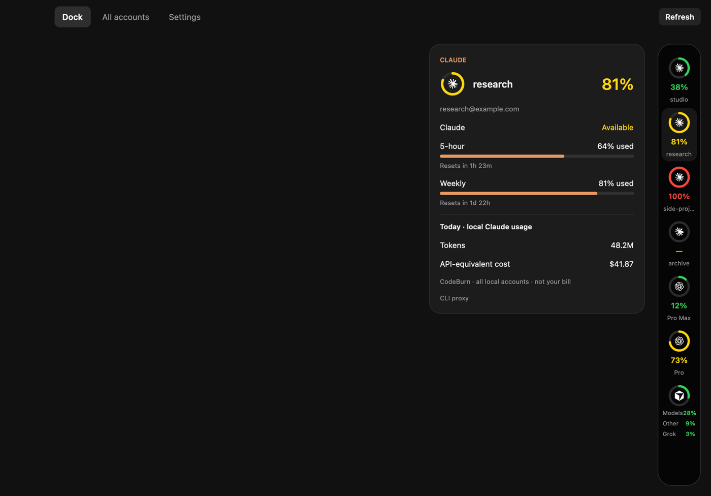
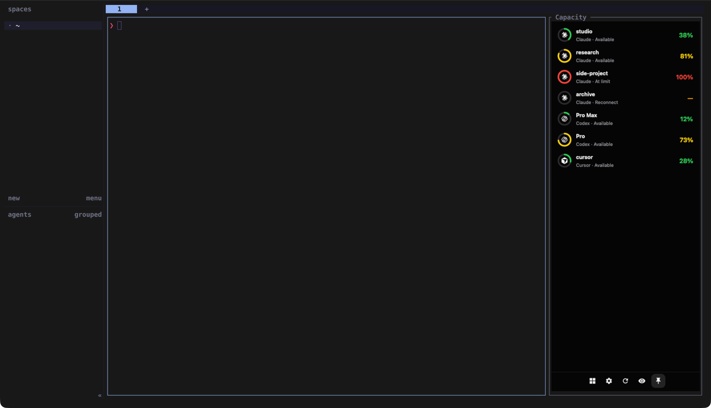
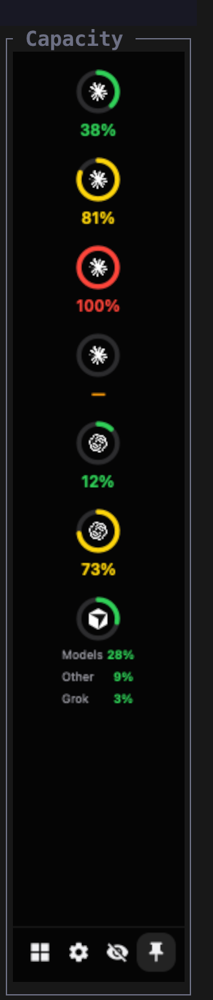
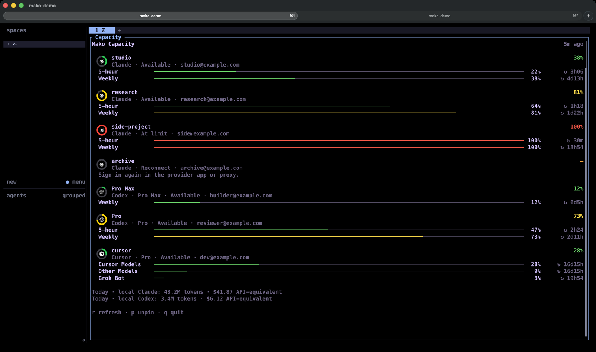

# Mako Capacity

A capacity dock for **every Claude and Codex account in your local CLIProxyAPI**,
plus your active **Cursor CLI account**. It keeps the original black dock, curved
edge flares, quota rings, provider icons, account labels, and inward-facing hover
bubbles inspired by [CodeBurn](https://github.com/getagentseal/codeburn).

<p align="center">
  
</p>



Screenshots use demo accounts. Downloads for macOS, Windows and Linux are on the
[releases page](https://github.com/Mako-L/account-capacity-dock/releases/latest).

> [!WARNING]
> **Windows and Linux are untested.** The developer has only run Mako Capacity on
> macOS. The Windows and Linux builds compile and pass the automated checks in
> GitHub Actions, but nobody has installed or used them on a real machine yet.
> Hands-on testing on both is on the [roadmap](#roadmap). Please open an issue if
> something breaks.

The original Swift/AppKit renderer remains the default on macOS to preserve its
appearance and menu-bar integration. Windows and Linux use the native Rust/egui
port in `native/`, with the same dock geometry and assets. Quota collection and
CodeBurn accounting run separately from rendering; a slow first usage scan does
not hold up the dock's quota refresh.

## Prerequisites

On every platform, install Git, **Python 3.9+**, **Node.js 22.13+** (including npm),
and Docker with **Compose v2**. Start Docker before running the complete setup.
[Docker Desktop](https://www.docker.com/products/docker-desktop/) is suitable for
macOS and Windows; Windows needs its Linux container engine. Linux can use Docker
Engine plus the Compose plugin.

| Platform | Native build requirements |
| --- | --- |
| macOS 14+, Intel or Apple Silicon | Xcode Command Line Tools: `xcode-select --install` |
| Windows 10/11 | [Rust stable](https://rustup.rs/) and Visual Studio Build Tools with **Desktop development with C++** |
| Linux desktop | Rust stable, a C toolchain, pkg-config, X11/Wayland/OpenGL development libraries |

For Debian/Ubuntu Linux:

```sh
sudo apt-get update
sudo apt-get install -y build-essential pkg-config libgl1-mesa-dev libx11-dev \
  libxi-dev libxcursor-dev libxrandr-dev libxinerama-dev libxkbcommon-dev libwayland-dev
```

The installer installs the pinned **CodeBurn 0.9.25** dependency locally under
`~/.mako-capacity/dependencies`; it does not replace your global CodeBurn install.
Python and Node paths are saved so the installed dock can run outside your shell.

## Install and start everything

macOS or Linux:

```sh
git clone https://github.com/Mako-L/account-capacity-dock.git
cd account-capacity-dock
./capacity install
export PATH="$HOME/.local/bin:$PATH"
```

Windows PowerShell:

```powershell
git clone https://github.com/Mako-L/account-capacity-dock.git
cd account-capacity-dock
.\capacity.cmd install
$env:Path = "$HOME\.local\bin;$env:Path"
```

Add that CLI directory to your persistent user PATH for future terminals. You can
also keep using `./capacity` or `.\capacity.cmd` from the checkout.

`install` creates private proxy directories and random Claude API/management
keys, installs CodeBurn, builds and installs the dock, starts the CLIProxyAPI
container (it serves Claude and Codex), and opens the app. Re-running setup preserves existing proxy
credentials and configuration. Add accounts next; setup cannot authenticate your
provider accounts for you. Keep this checkout because the installed CLI launcher
references `scripts/capacity.py`.

Installed UI locations:

- macOS: `~/Applications/Mako Capacity.app`.
- Windows: `%USERPROFILE%\.mako-capacity\bin\mako-capacity.exe`.
- Linux: `~/.mako-capacity/bin/mako-capacity`.

To use the Rust renderer on macOS as well, install Rust and run
`./capacity install --rust-ui`. This choice persists in `settings.json`. The
original Swift source and `build.sh` remain available.

### Install with an AI assistant

Paste this prompt into Claude Code, Codex, Cursor or another coding assistant that
can run commands on your computer. It checks the prerequisites, asks how your proxy
runs, and walks you through each step.

<details>
<summary>Show the install prompt</summary>

```text
Help me install Mako Capacity (https://github.com/Mako-L/account-capacity-dock) on this computer.

1. Check what I have: operating system and version, Git, Python 3.9+, Node.js 22.13+, and Docker with Compose v2 (running). On Windows and Linux, also check for the Rust toolchain. Tell me what is missing and how to install it. Wait for my yes before you install anything system-wide.
2. Ask me where my CLIProxyAPI runs: in Docker on this machine, already running on this machine, or on another server.
3. Clone the repository and follow its README for my answer:
   - Docker on this machine: ./capacity install (Windows: .\capacity.cmd install)
   - Proxy already running here: ./capacity install --app-only
   - Proxy on another server: ./capacity install --proxy-url URL --key KEY (ask me for both)
4. Help me add accounts with: mako-capacity login claude, login codex and login cursor. I complete each browser sign-in myself.
5. If I use Herdr, install the widget: herdr plugin install Mako-L/account-capacity-dock/herdr-plugin
6. If my proxy has the Expiring First plugin, point its quota_file at Mako's quota.json, as the README describes.
7. Check that it works: run mako-capacity doctor, and confirm the dock shows my accounts.

Never print, paste or commit tokens, keys, or files from the proxy's auths folder. Ask me before any command that deletes data or restarts Docker containers.
```

</details>

## Add your accounts

```sh
mako-capacity login claude   # repeat for each Claude account
mako-capacity login codex    # repeat for each ChatGPT account
mako-capacity login cursor   # requires the separately installed Cursor CLI
```

**Claude:** an interactive temporary container prints an authorization URL. Open
it in your browser and sign in to the intended account. The localhost callback
uses port **54545**; paste the full callback URL at the prompt if requested.
Credentials are saved in the persistent `auths/` directory. Repeat for each
account; the proxy watches that directory.

**Codex:** `mako-capacity login codex` works the same way through CLIProxyAPI,
with the callback on port **1455**. Codex logins land in the same `auths/`
directory. Point Codex at `http://127.0.0.1:8317/v1` with the key in `client-key`.
To ask for the fast tier on a model, add a `requests.payload.override` rule that
sets `service_tier: ultrafast` for it. The separate Codex Proxy is legacy: the
dock reads its `accounts.json` only while CLIProxyAPI has no Codex login.

**Cursor:** install the [Cursor CLI](https://cursor.com/docs/cli/installation),
then use `mako-capacity login cursor` or `cursor-agent login`. The CLI identity is
independent of the editor login. macOS reads the token from Keychain
(`cursor-access-token`, `cursor-user`); Windows/Linux use the CLI's file store at
`~/.cursor/auth.json`. The login command selects file storage outside macOS.

For Cursor CLI in Windows WSL, sign in inside WSL with
`AGENT_CLI_CREDENTIAL_STORE=file cursor-agent login`, then configure `CURSOR_DIR`
to the distro's accessible `.cursor` directory when initializing setup. The
Windows dock needs to be able to read its `cli-config.json` and `auth.json`.

**Cursor supports one active CLI identity.** Multiple Cursor account inventories,
account rotation, and Cursor traffic proxying are not provided by this stack.
Claude and Codex can show multiple accounts because the proxy keeps a local
account inventory. Refresh the dock after signing in.

## Token usage and dollar cost on hover

Every account's hover bubble and overview card include **today's local token
usage** and **API-equivalent USD cost** from CodeBurn, with separate input, output,
cache-read, and cache-write counts. Cursor uses CodeBurn's `cursor-agent` source,
so its CLI usage is separate from editor usage. Cursor's provider-reported
on-demand spend is shown separately for its billing cycle.

CodeBurn reads session logs on this machine. Those logs do not identify which
proxy account handled a request, so the cards clearly say **all local accounts**:
these are provider/tool totals, repeated for matching accounts, and must not be
summed across account cards. They are not account-specific billing totals, quota
percentages converted to tokens, or your subscription invoice.

Missing counters remain `—`. Estimated usage, incomplete indexing, missing model
prices, and stale results are labeled. The first CodeBurn scan can take several
minutes on a large session history. Quota checks continue while it runs, and
later usage refreshes reuse CodeBurn's cache. Only the selected summary fields
are saved in Mako Capacity's cache; transcripts and tokens used for authentication
are not copied into its snapshot.

## Use the dock

Hover an account for its quota windows, reset countdowns, status, token usage,
and cost. Click an account or the grid button to open all accounts. The gear
opens settings for scale, circular/rounded-square icons, account labels,
opacity, and screen edge. The dock fits the number of accounts automatically and
scrolls when the list exceeds the screen. The chosen icon shape applies in the
dock, hover details, and all-accounts view. Scroll edges use soft gradient shadows
inspired by Bubo’s `ShadowScrollView`: shadows appear only where there is more
content to scroll. Settings persist across launches.

The original macOS renderer also offers its menu-bar gauge, Command-comma,
drag-to-edge attachment, and positioning across Spaces. The portable renderer
uses native windows, a drag handle, dock settings, and a right-click menu for
refresh/quit. On Wayland, the compositor controls placement and always-on-top
behavior; the portable dock starts floating. X11 is recommended when you need
precise edge attachment. System font rendering can differ between platforms.

The ring reports **percent used**. Claude and Codex use their most constrained
quota window. Cursor's ring represents **Cursor Models**; **Other Models** and
**Grok Bot** appear separately on the rail and in detail. Exhausted, disconnected,
and unknown-capacity accounts remain visible.

To remove an account, use its card in **All accounts** (the `⋯` menu on macOS, the
buttons under the card in the portable renderer). **Hide** removes the account from Mako
only and keeps its credentials; **Hidden** in the header restores it. **Delete from
proxy** asks for confirmation, then removes the credentials through the proxy
API; sign in again to add the account back. The Cursor CLI login can
only be hidden. Hidden IDs live in `~/.mako-capacity/hidden.json`.

## Terminal and GPUIX app

`gpuix-app/` is the same dock, All accounts and Settings built on
[GPUIX](https://github.com/remorses/gpuix) (React on Zed's GPU renderer). It opens
as a native window, or draws inside the terminal you start it from:

```sh
mako-capacity ui                        # native window
mako-capacity ui accounts --terminal    # inside Ghostty or kitty, also over SSH
ssh -t my-server 'cd account-capacity-dock && ./capacity ui --terminal'
```

It needs [Bun](https://bun.sh); the first run installs its packages. The terminal
mode needs the Kitty graphics protocol, so it works in Ghostty and kitty but not
in tmux. Use Herdr 0.9 or newer (`herdr update`, run outside Herdr): it passes
pixel mouse positions and Kitty images through efficiently. Herdr 0.8 sends mouse
positions in character cells, so on 0.8 `mako-capacity ui --terminal` runs the app
through `gpuix-app/term.py`, which converts each click and scroll to the pixel
centre of its cell. Every button is also a Tab stop that Enter presses.

On Herdr 0.8 the app lags: every update crosses Herdr as a whole inline frame of
about 200 to 250 KB, so the 0.8 relay also drops plain pointer moves (set
`MAKO_TERMINAL_HOVER=1` to keep hover effects). Herdr 0.9 hands images to Ghostty
through local files instead.

In a narrow window or pane the app becomes the widget: under 480 px a row per
account, under 200 px the dock's column of rings, with the dock's buttons for
All accounts, Settings and Refresh at the bottom. A tap opens an account's card. It reads the same snapshot and uses the same collector actions (Hide,
Delete, Restore, proxy server) as the other renderers. GPUIX is pre-1.0, so the
versions are pinned exactly in `gpuix-app/package.json`.



## Herdr widget

Herdr users can dock the capacity view beside their panes.



It shows a progress ring per account, a bar per quota window, and reset
countdowns. It reads the same snapshot as the
dock and skips accounts hidden in the dashboard.

```sh
herdr plugin install Mako-L/account-capacity-dock/herdr-plugin
herdr plugin action invoke open-right --plugin mako-capacity   # or open-left
```

From a checkout, `herdr plugin link "$PWD/herdr-plugin"` installs your local copy instead.

<p align="center">
  
  
</p>

The layout follows the pane width: under 12 columns it shows only the rings,
centred. Under 30 columns it shows the ring (with the provider icon), percent and
a short name. From 50 columns it adds the plan,
email, notes and today's local usage when the pane is tall enough. If accounts do
not fit the height, each keeps only its tightest quota bar.
`MAKO_CAPACITY_WIDTH` sets the starting width (default 36). In the pane, `r` forces a refresh, `p` pins or
unpins and `q` closes it.

The rings are images drawn with the Kitty graphics protocol. They need a terminal
that supports it, such as [Ghostty](https://ghostty.org), Kitty or WezTerm, and
`kitty_graphics = true` under `[experimental]` in Herdr's config. This also applies
when you attach to Herdr over SSH: the terminal on the machine you type on draws
the rings. Other terminals, such as Termux, macOS Terminal or iTerm2, can show the
rings without their icons, or no rings at all. Set `MAKO_CAPACITY_RINGS=0` to use
the text layout instead.

To keep the widget in view everywhere, pin it:

```sh
herdr plugin action invoke pin-right --plugin mako-capacity   # or pin-left
herdr plugin action invoke unpin --plugin mako-capacity
```

In the widget, `p` pins or unpins it on its current side. Anywhere in Herdr, bind the
`toggle-pin` action to a key, for example in `~/.config/herdr/config.toml`:

```toml
[[keys.command]]
key = "prefix+alt+p"
type = "shell"
command = "herdr plugin action invoke toggle-pin --plugin mako-capacity"
```

While pinned, one widget moves into each tab you focus, so only one widget process
runs. Widgets and the tab bar line share one collector run per minute. For a one-line summary instead, add this to `[ui]` in `~/.config/herdr/config.toml`, then run
`herdr server reload-config`. The tab bar of every workspace then shows the percent
used per account (`✳` Claude, `◎` Codex, `⬡` Cursor) with a pie (`○◔◑◕●`), updated every minute:

```toml
tab_bar_right = [{ type = "command", command = "python3 \"$HOME/Documents/GitHub/account-capacity-dock/herdr-plugin/capacity.py\" --status", interval_seconds = 60, timeout_seconds = 30 }]
```

## Operations and troubleshooting

```sh
mako-capacity up                  # start the proxy and open the dock
mako-capacity open                # open only the dock
mako-capacity status              # show this stack's container
mako-capacity logs                # last 100 proxy log lines
mako-capacity doctor              # check native tools, CodeBurn, Docker, configuration
mako-capacity down                # remove containers; retain account data
```

`down` stops this stack's container; quit the dock separately. The container uses
`restart: unless-stopped` and returns when Docker starts. Add the installed app to
your operating system's startup/login items if you want the dock at login.

If Docker cannot connect, start its daemon/Desktop app. If a port is already
allocated, stop the conflicting service or select different host ports before
installation. On macOS/Linux:

```sh
CLAUDE_PROXY_PORT=18317 ./capacity install
```

On PowerShell, set `$env:CLAUDE_PROXY_PORT` before `.\capacity.cmd install`. The
port choice persists. Logins need their OAuth callback ports free: **54545** for
Claude and **1455** for Codex. A `—` in the dock includes an explanation in the
hover bubble.

## Recommended: Expiring First routing

[Expiring First](https://github.com/magoz/cpa-expiring-first) is a CLIProxyAPI
plugin that sends each request to the account whose weekly quota resets soonest
and still has quota left. Quota that would reset unused is spent first. It needs
fresh quota readings, and Mako Capacity writes them: every collector run saves
`state/quota.json` in the proxy folder, in the plugin's `expiring-first.quota.v1`
format. The file holds quota percentages and reset times only, no credentials.

1. Install **Expiring First** from the plugin store in the proxy dashboard
   (`http://localhost:8317/management.html`).
2. Point it at Mako's file in the proxy's `config.yaml`:

   ```yaml
   plugins:
     enabled: true
     configs:
       expiring-first:
         enabled: true
         quota_file: /CLIProxyAPI/state/quota.json
   ```

The Docker setup mounts that folder read-only at `/CLIProxyAPI/state`. If you run
the proxy another way, set `QUOTA_FILE` in `~/.mako-capacity/settings.json` to a
path the proxy can read. A remote proxy needs its own copy of the file, so Mako
does not write one in remote mode.

## Proxy on another machine

CLIProxyAPI can run on a server instead of in Docker on this computer. Point Mako
at it with the server address and its management key (the `MANAGEMENT_PASSWORD`
from that server's `management.env`):

```sh
mako-capacity proxy https://server:8317 --key MANAGEMENT_KEY
mako-capacity proxy local                     # back to the local Docker proxy
./capacity install --proxy-url https://server:8317 --key MANAGEMENT_KEY   # new install, no Docker
```

`proxy` checks that the server answers before it saves anything; a wrong key keeps
the last working setting. The same fields are in the dock's **Settings** under
**Proxy server**. Leave the address empty to use the local proxy.

With a remote proxy:

- The dock reads logins through the management API and keeps a private copy in
  `~/.mako-capacity/remote-auths/` (owner-only permissions), so it still shows the
  last known accounts if the server is unreachable. A banner names the problem.
- `mako-capacity login claude` and `login codex` print a sign-in link. After you
  sign in, paste the address from the browser's address bar at the prompt.
- **Delete from proxy** removes the login on the server.
- `up`, `down`, `status` and `logs` do not manage the server; run those there.

The management API returns account tokens. Use `https`, or reach the server
through an SSH tunnel or a private network such as Tailscale. The server needs
`allow-remote: true` under `management:` in its `config.yaml`, which this setup
writes by default.

## Storage and existing proxies

New installations keep persistent data under `~/.mako-capacity/` (on Windows,
`%USERPROFILE%\.mako-capacity\`):

| Directory/file | Contents |
| --- | --- |
| `claude-proxy/auths/` | Claude and Codex OAuth credentials managed by CLIProxyAPI |
| `claude-proxy/config.yaml`, `management.env`, `client-key` | Proxy configuration and generated local keys |
| `settings.json` | Proxy paths, ports, runtime paths, renderer selection |
| `dependencies/`, `codeburn-cache/` | Installed CodeBurn and its separate accounting cache |

The credential-free snapshots are stored in:

- macOS: `~/Library/Application Support/Mako Capacity/`.
- Windows: `%LOCALAPPDATA%\mako-capacity\`.
- Linux: `${XDG_CACHE_HOME:-~/.cache}/mako-capacity/`.

Proxy data is private: do not commit it or share it in logs. The API and callback
ports bind to **127.0.0.1**. The management endpoint allows requests from the
Docker bridge and requires the random password in `management.env`; its optional
dashboard is `http://localhost:8317/management.html`. `client-key` separately
authenticates API traffic. Setup does not change model routing in your shell or
editor. Credential renewal remains with the upstream tools.

Already running a proxy? Install the dock and CodeBurn without starting Docker:

```sh
./capacity install --app-only
```

Without a configured proxy path, the collector reads `~/claude-proxy/auths/`. To
persist a custom existing location first:

```sh
CLAUDE_PROXY_DIR="$HOME/claude-proxy" ./capacity init
./capacity install --app-only
```

An older separate [Codex Proxy](https://github.com/icebear0828/codex-proxy) still
works as a read-only source: set `CODEX_PROXY_DIR` and the dock reads its
`data/accounts.json` until CLIProxyAPI has a Codex login.

`init` preserves existing files and does not start containers. The saved Claude
inventory in `~/.claude-swap-backup/sequence.json` supplies labels for matching
proxy accounts. It supplies accounts only when no proxy `auths/` directory exists;
deleted proxy accounts stay removed, even when they remain in that backup.
The dock and All accounts view check the local inventory every ten seconds.
[.env.example](.env.example) lists optional path, port, and memory settings.

The proxy image in [deploy/compose.yaml](deploy/compose.yaml) is pinned by
digest. Pull this repository and re-run `install` to update the app. Upgrading
the proxy image requires changing its Compose digest and running `up`; account
data survives container replacement. Back up the private data before upstream
upgrades.

## Development and checks

```sh
# Portable native UI (Rust stable required on macOS too):
cargo run --locked --manifest-path native/Cargo.toml
cargo test --locked --manifest-path native/Cargo.toml

# Original macOS renderer:
./build.sh
open 'build/Mako Capacity.app'

# Collector checks and credential-free JSON:
python3 -m unittest discover -s tests -v
python3 collector.py --skip-usage
```

The portable binary embeds its Python helpers and provider assets. Its UI thread
never waits for quota requests or CodeBurn indexing. GitHub Actions runs Rust and
Python checks on macOS, Windows, and Ubuntu. A deterministic native UI preview can
be launched with `--preview /path/to/snapshot.json` for visual verification.

## Roadmap

- Install and use the portable dock on Windows and Linux, and fix what breaks.
- Test the Herdr widget on Linux.
- Test a CLIProxyAPI running on a separate server, not only on the same machine.

## Credits and licenses

Mako Capacity's code is [MIT licensed](LICENSE). The original interaction and
visual design are based on CodeBurn's Capacity Dock. The dock shape, hover tail,
ring geometry, provider assets, and quota conventions retain CodeBurn's MIT
attribution. Cursor interpretation and its cube icon follow the custom local
LLimit app. This repository is separate from both full apps.

| Project | Contribution | License / attribution |
| --- | --- | --- |
| [CodeBurn](https://github.com/getagentseal/codeburn), AgentSeal | Original dock design, geometry, icons, quota conventions, token/cost accounting dependency | MIT; [bundled notice](Resources/CodeBurn-LICENSE.txt); npm package includes third-party notices |
| [LLimit](https://github.com/githajae/LLimit), githajae | Cursor quota labels/rounding and cube icon | MIT; [bundled notice](Resources/LLimit-LICENSE.txt) |
| [CLIProxyAPI](https://github.com/router-for-me/CLIProxyAPI), Router-For.ME and contributors | Claude and Codex OAuth account store and Docker service | [MIT](https://github.com/router-for-me/CLIProxyAPI/blob/main/LICENSE) |
| [Herdr](https://herdr.dev) | Terminal workspace that hosts the optional widget | Separately installed; Herdr terms apply |
| [egui/eframe](https://github.com/emilk/egui), Emil Ernerfeldt and contributors | Native Rust rendering/window integration | MIT or Apache-2.0 |
| [serde](https://serde.rs/), [serde_json](https://github.com/serde-rs/json) | Rust snapshot decoding and settings | MIT or Apache-2.0 |
| [dirs](https://github.com/dirs-dev/dirs-rs) | Native platform directory locations | MIT or Apache-2.0 |
| [image](https://github.com/image-rs/image) | Provider image decoding | MIT or Apache-2.0 |
| [Cursor CLI](https://cursor.com/docs/cli/overview), Anysphere | Cursor CLI identity and quota endpoints | Separately installed proprietary tool; Cursor terms apply |

The macOS renderer uses Apple's AppKit, SwiftUI, and Combine frameworks. Collectors
and setup use Python's standard library. Rust/Cargo, Node/npm, Docker/Compose, and
provider services retain their own licenses and terms. This repository's MIT
license does not relicense upstream container images or services.
