# Capacity for phones, widgets, Apple Watch and Wear OS

The phone version of the Mako Capacity dock. It reads the same CLIProxyAPI management API the desktop collector reads and shows each account's quota ring, percent used and reset countdown.

Built with [One](https://onestack.dev/) 2.17 (React Native + web). One's own `one prebuild` generates the iOS and Android projects and the iOS WidgetKit extension, so no Expo is involved. One has no watchOS, Wear OS or Android widget targets, so two post-prebuild scripts add them: `scripts/add-watch-target.rb` (watchOS app and complication) and `scripts/add-android-widget.mjs` (Android widgets and the `:wear` module).

| List | Detail | Settings |
| --- | --- | --- |
| 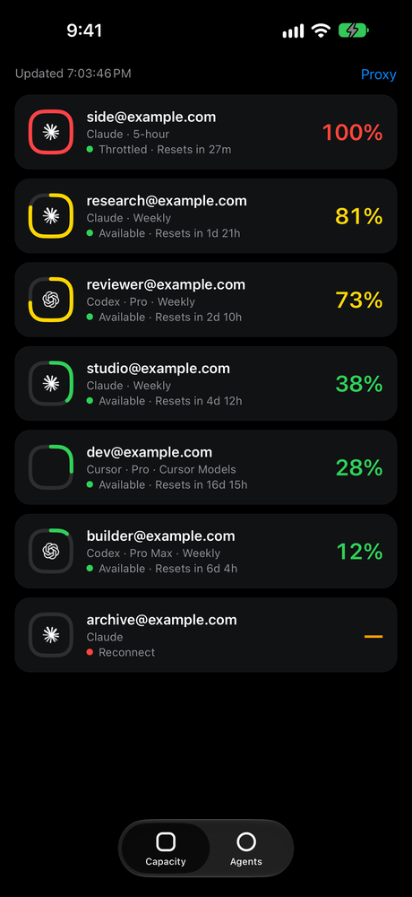 | 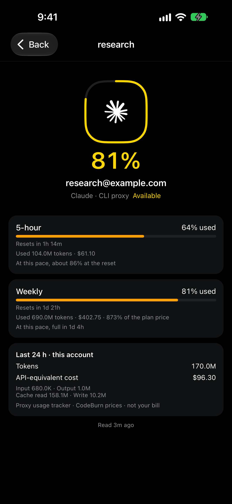 | 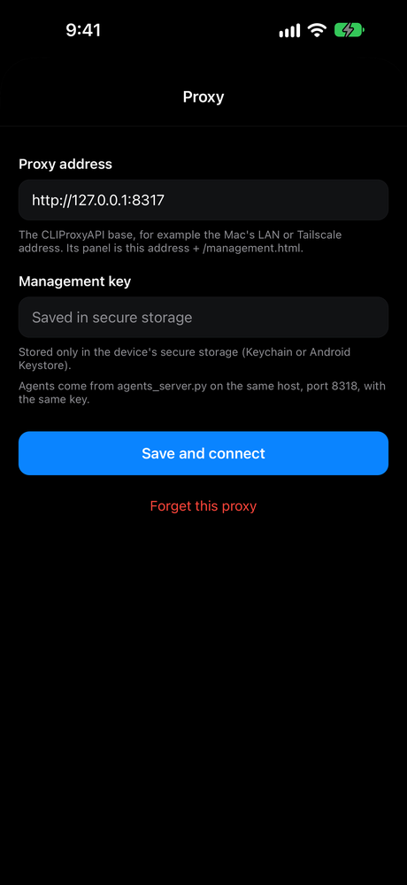 |

| Widgets | Watch | Watch, scrolled |
| --- | --- | --- |
| 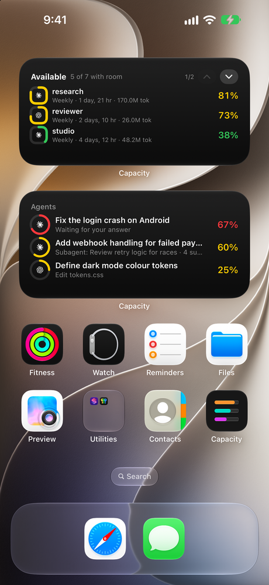 | 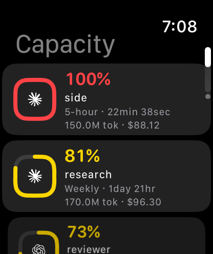 | 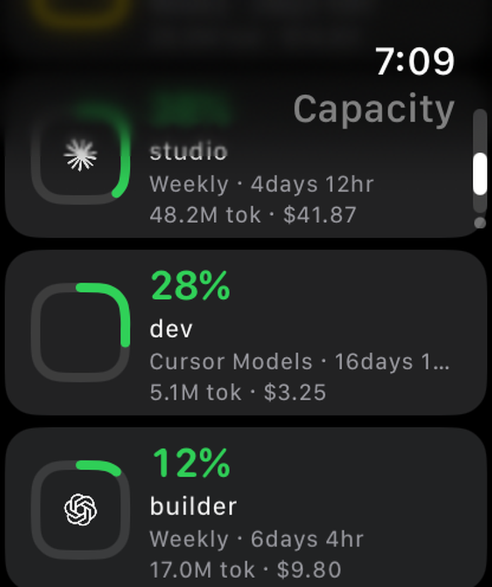 |

## What it shows

- **Accounts list:** one row per proxy login, with the dock's rounded-square quota ring, the provider icon, percent used of the most constrained window, the reset countdown and a connected / reconnect state. Pull to refresh.
- **Account detail:** the dock's account card: every quota window with its ring, percent, reset, spend detail, "at this pace" projection and tokens spent inside the window, plus the last 24 h (or today's local) tokens and cost, on-demand spend, plan, source and proxy login state.
- **Settings:** the proxy address and management key. The agents server is always the same host on port 8318, so it needs no setting.
- **Widgets, "Available" and "All":** "Available" lists only the accounts that still have usage left, "All" lists every account, most constrained first, with ring, name, window, reset and percent.
  - Android: resizable collection widgets that scroll top to bottom like the dock bar.
  - iOS: WidgetKit cannot scroll, so the medium and large sizes page through the list with up and down buttons (App Intents). The medium size shows 3 rows a page, the large 7.
- **Apple Watch app:** the same rings and percents, pushed from the iPhone over WatchConnectivity.
- **Wear OS app:** one scrolling list, accounts then agents, pushed from the Android phone over the Wearable Data Layer. It has the phone app's id and signing key, which the Data Layer requires.
- **Watch complication:** the most constrained account as a ring (circular, corner), or the top accounts (rectangular, inline).
- **Wear OS watch face and complications:** see [Wear OS watch face](#wear-os-watch-face).
- **Agents tab:** the Mac dock's agents mode. One row per coding agent with its circle ring, task, current step, step count, progress and state (working, needs you, finished, idle). Idle agents are hidden unless "Show idle" is on. Tap a row for the dock's agent card: every step with its time, the subagents and workflows with their own progress, recent activity, model, tokens and run time.
- **Agents widget (iOS medium and large, Android 4x2):** the agents that need you or are working first, with ring, task, step and progress.
- **Watch agents page:** swipe down past the accounts for the same agents list.

## Agents

The agents come from the Mac's `agents.json`, which the dock writes (`agents.py`). The phone cannot read Mac files, so `agents_server.py` at the repo root serves it read-only:

```bash
python3 agents_server.py                  # this Mac only, port 8318
python3 agents_server.py --host 0.0.0.0   # also the LAN and Tailscale addresses
```

- `GET /v0/agents` with `Authorization: Bearer <management key>`: the same key as the proxy, read from the same place as `collector.py`.
- `GET /v0/capacity`, same key: the dock's own `snapshot.json` (without usage history), so the phone shows exactly the dock's accounts, including CodeBurn spend. If the Mac is unreachable, the phone falls back to reading the proxy directly.
- It drops prompts, transcripts, folders and replies: only title, task, current step, steps, progress, status and timestamps leave the Mac.
- If the dock is not running, the server collects a fresh snapshot itself, at most every few seconds.
- The phone always uses the proxy host on port 8318.

To run it on the Mac for good and reach it over Tailscale:

```bash
cp docs/com.mako.capacity-agents.plist ~/Library/LaunchAgents/   # edit the path to agents_server.py first
launchctl bootstrap gui/$(id -u) ~/Library/LaunchAgents/com.mako.capacity-agents.plist
tailscale serve --bg --tcp 8317 tcp://127.0.0.1:8317
tailscale serve --bg --tcp 8318 tcp://127.0.0.1:8318
```

Then set the proxy address on the phone to the Mac's Tailscale IP, for example `http://100.x.y.z:8317`.

The rules match the dock (`collector.py`, `App.swift`): percent used is the highest window, the limiting window is the one with the highest use, the reset is that window's reset, and the ring colour follows the same green / yellow / orange / red thresholds.

### What the phone cannot show

These come from the desktop collector, not from the proxy, so the phone leaves them out rather than guess:

- **CodeBurn spend and local token counts** (`codeburn_usage`, the per-window token and cost lines). They are read from the Mac's local session logs.
- **Cursor.** The dock reads Cursor from the Mac's Cursor app database; the proxy holds no Cursor login.
- **Local logins the proxy does not hold** (for example a Claude login only in the Mac keychain).

## Data source and secrets

The settings screen takes the proxy address and the management key. The panel is at `<address>/management.html`.

- On a phone, use the Mac's LAN or Tailscale address, for example `http://192.168.1.20:8317` or `http://100.x.y.z:8317`. `127.0.0.1` only works in the simulator.
- The proxy must listen on that interface. A proxy bound to `127.0.0.1:8317` only (the default Docker publish) cannot be reached from a phone.
- Plain `http` is accepted for loopback, private LAN ranges (10/8, 172.16/12, 192.168/16), Tailscale (100.64/10) and `.local` / `.ts.net` names. Any other host needs `https`.
- Android allows cleartext traffic app-wide through `res/xml/network_security_config.xml`, because that file cannot express IP ranges. The URL rule above is what keeps plain http to private hosts.
- iOS keeps the React Native template's `NSAllowsLocalNetworking`, which allows http to IP addresses and `.local` names but not to a `.ts.net` name: on iPhone, use the Tailscale IP.
- The key is stored only in the iOS Keychain or Android Keystore, through `One.SecureStore`. It never goes to plain storage, logs or the snapshot shared with the widgets and watch.
- The app calls `GET /v0/management/auth-files` for the logins and `POST /v0/management/api-call` to read each provider's usage endpoint with the proxy's stored token, like `collector.py`. Provider tokens never reach the phone.
- The widgets and watch receive a snapshot with provider, label, percent, window, reset time and state only.

## Setup

Requirements: Bun 1.3+ and Node 24. For iOS: macOS with Xcode 27, CocoaPods and the `xcodeproj` Ruby gem (installed with CocoaPods), plus a watchOS simulator runtime for the watch app. For Android: the Android SDK (platform 36, build-tools 36) and Java 17.

```bash
cd mobile
bun install
bun run prebuild:ios       # one prebuild --platform ios, then the watch app and complication
bun run prebuild:android   # one prebuild --platform android, then the widgets and network config
```

`ios/` and `android/` are generated. After changing `vite.config.ts`, `native/` or `targets/`, run the prebuild again.

## Android APK

```bash
cd mobile/android
JAVA_HOME=$(/usr/libexec/java_home -v 17) ANDROID_HOME=~/Library/Android/sdk \
  ./gradlew assembleRelease -PreactNativeArchitectures=arm64-v8a
# android/app/build/outputs/apk/release/app-release.apk
```

One ABI keeps the build under 4 GiB of disk; all four ABIs needed over 10 GiB. The release build bundles the JavaScript, so it runs without a dev server. It is signed with the debug key, which is enough to sideload. Install it with `adb install app-release.apk`, or copy it to the phone and open it.

## Wear OS watch face

| Face | Ambient | Tap on an agent ring | Picker: top agent | Picker: accounts |
| --- | --- | --- | --- | --- |
| 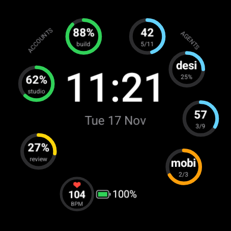 | 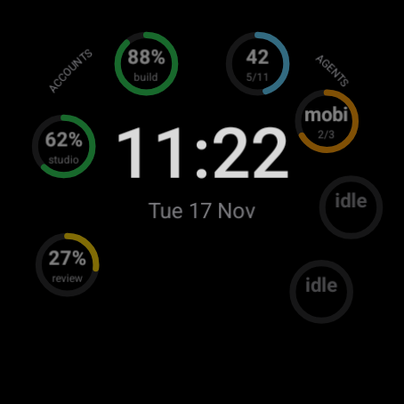 | 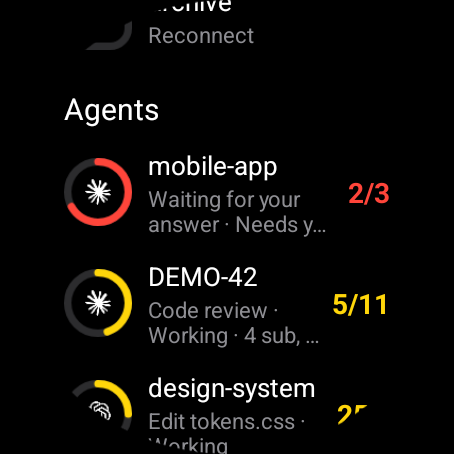 | 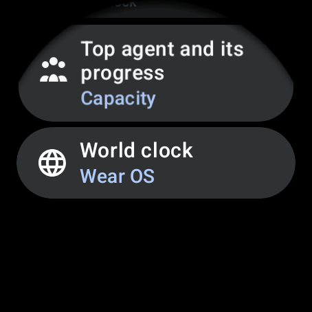 | 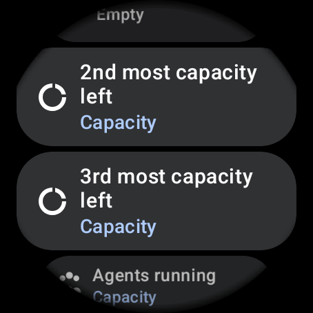 |

Two packages, built together:

- `wear` (`dev.mako.capacity`): the Wear app. It also exposes nine complication data sources, listed under "Capacity" in any face's picker: **Top agent and its progress**, **2nd running agent**, **3rd running agent**, **4th running agent** (each `RANGED_VALUE`, `SHORT_TEXT`, `LONG_TEXT`), **Agents running**, **Most capacity left**, **2nd most capacity left**, **3rd most capacity left**, **4th most capacity left** (each `RANGED_VALUE` and `SHORT_TEXT`). The picker shows the app's sources in two places: a group at the top, and the full alphabetical list further down, where the ones missing from the group sit. They read the snapshot the phone pushes over the Data Layer, and refresh when a new one arrives.
- `watchface` (`dev.mako.capacity.watchface`): a Watch Face Format v2 face, resource only (`hasCode="false"`, minSdk 34).

| Slot | Shows | Data |
| --- | --- | --- |
| Time, date | 24/12 h per the watch setting | WFF clock |
| Battery | percent | WFF `[BATTERY_PERCENT]` |
| Weather | temperature and condition icon | WFF `[WEATHER.*]`, hidden when the watch has no reading |
| Section labels | "ACCOUNTS" over the left arc, "AGENTS" over the right arc, curved along the bezel | WFF `TextCircular` |
| Left arc: 3 account rings | percent left (bold) and the account name, cut to 6 characters, ring green 50%+, yellow 20%+, red below | the app's 1st to 3rd "capacity left" sources, user changeable |
| Right arc: 4 agent rings | one running agent each: the ticket number (bold, digits only, e.g. "42"), else the first 4 letters of its name, and the stage count (else a percent) under it. The ring fills with stage progress: blue while it works, amber while it waits on you. A slot with no agent shows a grey "idle" ring | the app's "Top agent" and 2nd to 4th "running agent" sources, user changeable. A tap opens the app at its agent list |
| Bottom: health | stress gauge with the label "stress", else a heart icon over the heart rate and "BPM" | default Samsung Health stress complication (`SMALL_IMAGE`, drawn 64 px), falling back to the system heart rate provider, user changeable |

Watch Face Format allows at most 8 complication slots on a face, so the left arc holds 3 accounts, not 4. The "4th most capacity left" source exists for other faces.

Samsung Health's stress complication (`com.samsung.android.wear.shealth/.complications.stress.StressComplicationProviderService`) only offers `SMALL_IMAGE` and `ICON`, so it draws as an image with no number. If Samsung Health is missing or refuses the face, the slot falls back to heart rate. Stress shows only on a Galaxy Watch with Samsung Health. The emulator cannot run it (its Wear APK ships only 32-bit ARM libraries), so the stress gauge on a real watch is not verified.

Build: `./gradlew :wear:assembleRelease :watchface:assembleRelease`. The face's XML passes Google's `wff-validator` for format version 2.

Install on a watch: install the Wear app APK first, then the face APK, then pick "Mako Capacity" from the watch's face list (long press the current face). Without the Wear app the face still loads, but the rings and agents slots stay empty.

Demo data (debug builds only): `src/debug` adds a receiver that loads `demo_snapshot.json`, made from `scripts/demo_data.py`. On an emulator, open the app once, then run `adb shell am broadcast -a dev.mako.capacity.wear.DEMO_DATA -n dev.mako.capacity/.wear.DemoDataReceiver`. Release builds do not contain it.

## iOS simulator

```bash
bun run dev -- --port 8131   # One dev server for Debug builds; pick a free port
cd ios
xcodebuild -workspace MakoCapacity.xcworkspace -scheme MakoCapacity -configuration Debug \
  -destination 'platform=iOS Simulator,name=iPhone 18 Pro Max' -derivedDataPath ../build-ios/dd \
  CODE_SIGN_STYLE=Manual CODE_SIGN_IDENTITY=- DEVELOPMENT_TEAM= PROVISIONING_PROFILE_SPECIFIER= build
xcrun simctl install booted ../build-ios/dd/Build/Products/Debug-iphonesimulator/MakoCapacity.app
xcrun simctl spawn booted defaults write dev.mako.capacity RCT_jsLocation -string localhost:8131
xcrun simctl launch booted dev.mako.capacity
```

- Do not pass `-sdk iphonesimulator`: it forces the watch target onto the iOS SDK and the build fails.
- Sign ad hoc (`CODE_SIGN_IDENTITY=-`). With `CODE_SIGNING_ALLOWED=NO` the app has no entitlements, so the Keychain fails with `-34018` and the App Group is unavailable.

Watch app: pair a watch simulator with the iPhone simulator (`xcrun simctl pair <watch> <phone>`), boot it, and install `Debug-watchsimulator/CapacityWatch.app` from the same build. Open the phone app: each refresh is sent over WatchConnectivity.

Widgets: long-press the home screen, tap Edit, then Add Widget, then pick Capacity.

## Tests

```bash
bun run test        # dock rules: windows, percent, colours, reset text, widget snapshot
bun run typecheck
```

## Not verified

- **Android on a device or emulator.** The APK builds and its manifest holds both widget receivers and the network config, but no emulator image is installed, so it has not run.
- **Wear OS face on a real watch.** Verified on the Wear OS 5 emulator (API 34) only: face, picker, demo data, release APKs. Not checked: a Samsung watch, Samsung Health's stress provider in a third-party face, live weather, and the phone push reaching the complications.
- **Watch complication on a face.** It builds, watchOS registers it with all four families and launches its extension, but the simulator's complication picker does not list it. Check on a real watch.

## Layout

```
app/                    screens (list, account/[id], settings)
components/             Ring (native SwiftUI on iOS, react-native-svg elsewhere), rows, icons
features/capacity/      proxy client, dock rules, store, secure config, widget and watch publishing
lib/request.ts          the one network call
native/Capacity/        Swift: App Group + WatchConnectivity bridge, the SwiftUI ring
native/CapacityAndroid/ Kotlin: writes the snapshot for the Android widget and refreshes it
targets/widget/         SwiftUI WidgetKit extension (replaces One's generated widget body)
targets/watch/          SwiftUI watchOS app
targets/watch-complication/ watchOS WidgetKit complication
targets/android/        Android AppWidgetProvider, layouts and network security config
targets/android/wear/   Wear OS app and its complication data sources
targets/android/watchface/ Wear OS Watch Face Format face (resource only)
scripts/                post-prebuild scripts, app icon generator
```
